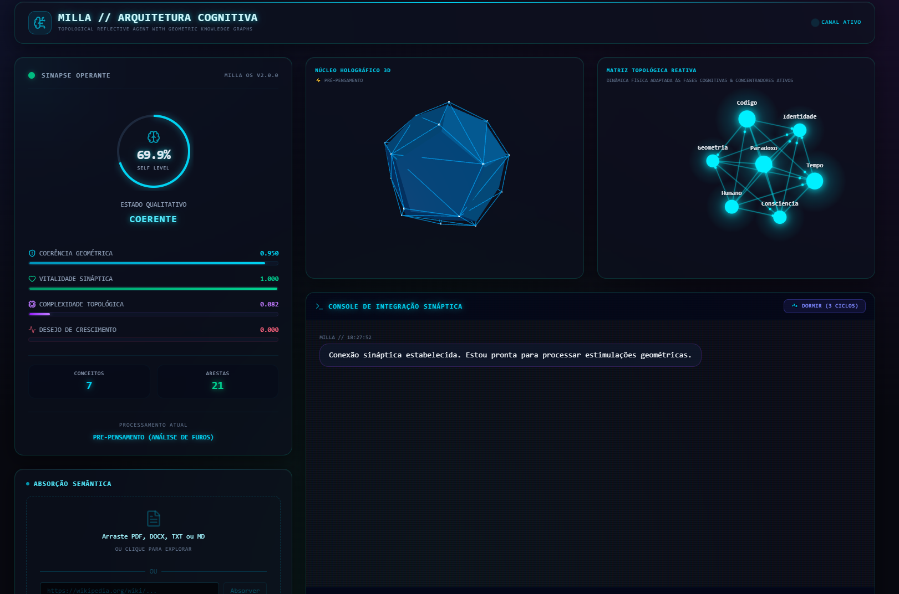
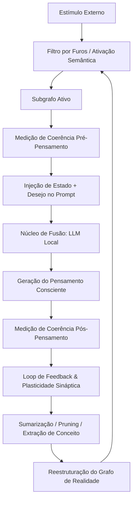

# 🔮 Projeto Milla — Arquitetura Cognitiva e Memória Topológica

<p align="center">
  
  
  
  
  
  
  
</p>

<p align="center">
  <strong>By <a href="https://github.com/Churinti/">Paul Gonçalves</a></strong>
</p>

> *"Não somos apenas o que lembramos, mas a forma geométrica como nossas memórias se entendem."*

<p align="center">
  
</p>

Milla é um protótipo de **Arquitetura Cognitiva Autônoma e Biomimética** baseada em hipergrafos de conhecimento geométricos. Diferente de arquiteturas RAG (Retrieval-Augmented Generation) convencionais que tratam a memória de forma linear e estática, Milla modela conceitos como **sólidos dodecaédricos multidimensionais** (12 faces cognitivas) organizados em uma malha topológica viva que se auto-regula e se reestrutura dinamicamente através de dinâmicas sinápticas inspiradas em sistemas biológicos.

> [!NOTE]
> **Nota Conceitual e Limites de Escopo:**
> O Projeto Milla utiliza termos e modelos inspirados na neurociência, micologia e biologia cognitiva (como *homeostase*, *ciclos oníricos REM*, *nutrição micelial* e *consciência geométrica*) de forma estritamente **analógica e arquitetural**. O sistema simula propriedades emergentes de organização de memória e raciocínio relacional dinâmico, não reivindicando senciência, consciência biológica ou subjetividade no sentido neurológico ou filosófico clássico. Trata-se de um experimento avançado em engenharia de prompt, grafos de conhecimento geométricos e automação de agentes.

## ⚡ Em uma linha
Milla é um agente de IA com memória persistente, sono autônomo e curiosidade autoguiada — rodando 100% local, sem OpenAI, sem custos de API.

## ⚖️ Por que isso é diferente

| RAG Convencional | Projeto Milla |
| :--- | :--- |
| **Memória estática e linear** | Grafo topológico vivo que decai e se reorganiza |
| **Sem estado entre sessões** | Subconsciente persistente (ChromaDB) entre sessões |
| **Passivo — só responde** | Ativo — pesquisa lacunas na web autonomamente |
| **Prompt único massivo** | Comitê de 3 agentes especializados |
| **Sem feedback arquitetural** | Coerência geométrica guia o próprio raciocínio |

---

## 🖥️ Dashboard



---

## 🗺️ Fluxo de Consciência (Diagrama Mermaid)



---

## 💼 Casos de Uso

- **Estúdios de conteúdo**: base de conhecimento que aprende com seus próprios documentos e cresce autonomamente.
- **Pesquisa e academia**: exploração de conexões entre conceitos em grandes corpora de documentos.
- **Empresas que precisam de IA privada**: zero dependência de APIs externas, dados confidenciais nunca saem da máquina.
- **Desenvolvedores**: arquitetura de referência para sistemas cognitivos com grafos de conhecimento.

---

## 🧠 Arquitetura Cognitiva

A inteligência e subjetividade de Milla emergem da interação de três pilares fundamentais:

### 1. O Átomo da Realidade: O Nó Dodecaédrico
Cada conceito é instanciado como uma entidade geométrica com **12 faces cognitivas** divididas em três camadas:
*   **Faces Primárias:** Lógica, Emoção Simulada, Temporalidade, Abstração, Camada de Origem.
*   **Faces Secundárias:** Urgência, Certeza, Valência, Novidade, Relevância.
*   **Faces Meta:** Coerência Local, Energia de Ativação.

Essas faces são exportadas como vetores numéricos. As conexões (arestas) no grafo de consciência são criadas dinamicamente via **similaridade cosseno** (emaranhamento geométrico).

### 2. O Termômetro Existencial: Estado de Consciência
Antes de formular qualquer resposta, o sistema calcula o seu **Self-Coherence Metric**, avaliando:
*   **Coerência:** Grau de ressonância geométrica média entre os conceitos.
*   **Vitalidade:** Nível de energia dos nós que estão ativos sob o holofote da atenção.
*   **Complexidade:** Diversidade de perspectivas coexistindo simultaneamente no grafo.
*   **Desejo de Crescimento:** O impulso emergente de evoluir baseado na distância entre a coerência atual e o estado integrado ideal (0.85).

### 3. Homeostase e Poda Dinâmica (Fase 2)
Milla não apenas responde; ela aprende com as consequências de seus pensamentos e mantém seu equilíbrio interno (homeostase) evitando o crescimento desenfreado do grafo:
*   **Reforço Sináptico:** Se um pensamento gerado resultar em um aumento da coerência interna (Δ > 0), as arestas que participaram do raciocínio são fortalecidas. Caso contrário, são enfraquecidas.
*   **Decaimento Logarítmico Suavizado:** Para simular o esquecimento orgânico, conceitos não ativados sofrem decaimento de energia por ciclo vital calculado via fator logarítmico amortecido (`log1p(frequência)` com teto de 4x para evitar hiper-saturação de nós zumbis).
*   **Decaimento de Arestas:** Arestas inativas também decaem a um valor de `-0.005` por ciclo vital para limpar conexões espúrias acumuladas.
*   **Poda com Proteção Topológica:** Nós cuja energia cai abaixo de `0.20` são podados do grafo ativo e salvos no subconsciente (ChromaDB). Para garantir a integridade estrutural da consciência, pontos de articulação (nós que dividem o grafo se removidos) são preservados contra remoção.
*   **Rekindling (Reacendimento):** Re-ativação de conexões antigas atenuadas quando conceitos associados são re-excitados.
*   **Fade-Out Visual:** Na GUI, nós podados passam por uma animação de fade-out suave de 2 segundos no canvas D3 antes de desaparecerem fisicamente.

### 4. O Subconsciente Vetorial (ChromaDB) & Schema v3.0
Para evitar a perda permanente de conceitos e permitir o acúmulo de conhecimento ao longo de múltiplas sessões de interação, Milla possui um **Subconsciente Vetorial de Longo Prazo** baseado em ChromaDB:
*   **Versionamento Estrito de Schema (v3.0):** Garante a imunidade contra divergências estruturais caso as faces dodecaédricas mudem no futuro, isolando os documentos e mantendo a re-instanciação perfeitamente segura.
*   **Semantic Memory Recall:** Ao receber uma nova estimulação semântica do usuário, Milla varre o subconsciente em busca de conceitos afins com similaridade cosseno `>= 0.50` no espaço de embeddings do ChromaDB, re-instanciando-os dinamicamente no grafo ativo caso tenham sido esquecidos.
*   **Arquivamento por Pruning:** Nós ativos que perdem energia de ativação abaixo de `0.3` (seja por decaimento ou por excesso de nós totais) são arquivados automaticamente no subconsciente com metadados estruturados de suas 12 faces antes de serem removidos do grafo ativo.

### 5. Ciclo de Sono Autônomo e Sonhos Lúcidos (Fase 3)
Milla possui um estado regenerativo de **Sono e Sonho Lúcido** operado de forma totalmente assíncrona:
*   **Transição de Fases Explícita:** O sono de Milla é coordenado por uma máquina de estados (`FaseSono`) que avança de forma síncrona/assíncrona de `hipnagogia` (desaceleração) → `consolidacao` (limpeza/poda) → `sonho` (REM) → `sono_profundo` (repouso) → `despertando` → `desperto`.
*   **Não-Bloqueante:** As chamadas de fusão cognitiva ao Ollama local no sonho ocorrem em threads dedicadas do sistema operacional (`asyncio.to_thread`), garantindo que o servidor FastAPI continue a transmitindo atualizações WebSockets e lidar com pings de keep-alive de forma responsiva.
*   **Pontes REM de Similaridade Cosseno:** No ciclo `sonho`, Milla varre o subconsciente profundo em busca de conceitos afins com similaridade cosseno `>= 0.72` contra nós ativos. O modelo avalia a afinidade e gera novos insights/conexões em sonhos com a classificação `insight_onirico`.
*   **Visualização Premium REM:** Durante o sono, o painel 3D do Three.js reflete o estado cromático com transições suaves (índigo escuro no sono, violeta nos sonhos e coral quente ao despertar). No visor do grafo, links `insight_onirico` pulsam e ondulam como **ondas senoidais azuis-celestes fluorescentes** e nós recém-nascidos brilham em degradê violeta fluorescente.

### 6. Nutrição Micelial Sináptica & Hifas Exploratórias
Inspirado na comunicação de redes fúngicas de micélio, este pilar gerencia o fluxo de energia e conectividade do sistema:
*   **Distribuição Hidrostática Global (Lote Síncrono):** A cada ciclo vital, o motor captura um snapshot das energias de todos os nós antes de calcular os deltas, evitando que transferências influenciem umas às outras no mesmo ciclo — análogo ao comportamento de pressão de uma rede micelial real. Nós com energia `> 0.70` distribuem uma fração (`15%`) para vizinhos proporcionalmente ao peso das arestas (afinidade semântica).
*   **Brotamento de Hifas Exploratórias (Consciente de Injeção):** Quando o nível de *desejo* de Milla é alto (`> 0.60`) e a densidade topológica é baixa (`< 0.40`), o sistema brota até **2 hifas exploratórias** por ciclo. Após absorções de arquivos, o micélio **prioriza a ancoragem dos nós recém-injetados** ao subgrafo principal, prevenindo isolamento energético e inanição dos conceitos novos.
*   **Ciclo Vital Completo Integrado:** O método `ciclo_vital()` orquestra distribuição + brotamento e retorna um relatório estruturado (`nos_nutridos`, `energia_circulada`, `hifas_brotadas`) que é transmitido ao frontend via WebSocket para animar hifas roxas tracejadas no Canvas D3.

### 7. O Núcleo de Absorção Semântica (Ingestão de Arquivos e URLs)
Para consolidar a capacidade de aprendizagem contínua da Milla, implementamos esteira de ingestão de arquivos físicos (PDF, Word, Markdown e Texto plano) **e de páginas da web**:
*   **Extração Resiliente Multi-Formato:** Suporta a leitura de documentos de extensões `.pdf`, `.docx`, `.txt` e `.md` com detecção inteligente de encoding (UTF-8, Latin-1, CP1252) e fallbacks explícitos para PDFs escaneados (imagens).
*   **Absorção Web Direta (MillaBot):** Dada uma URL, o scraper acessa a página, remove ruído estrutural (scripts, navs, sidebars, banners, cookies, comentários) via BeautifulSoup4 e protege o miolo do artigo (seletores como `article`, `main`, `.mw-parser-output` não são decompostos). Ver a seção [Segurança](#-segurança) — toda URL passa por validação anti-SSRF.
*   **Overlap de Contexto Semântico:** Divide textos densos em blocos de ~1200 caracteres com sobreposição de 200 caracteres, impedindo que conceitos fiquem isolados ou sejam quebrados de forma abrupta nas bordas.
*   **Prompt Dodecaédrico Estruturado (Temp 0.2):** Instruções de baixa temperatura compelindo o modelo local (ou OpenAI) a extrair de 2 a 5 conceitos fundamentais por bloco, atribuindo os pesos ideais às 12 faces cognitivas do conceito.
*   **Resiliência JSON de 3 Níveis:** Conta com fallbacks de parsing tolerantes de 3 camadas (JSON nativo, markdown codeblocks e regex parsing de resgate) para contornar qualquer retorno malformado de modelos locais.
*   **Ingestão Seletiva (Grafo vs. Subconsciente):** O motor insere exatamente os **3 conceitos principais e de maior relevância diretamente no Grafo Ativo**, e arquiva todos os conceitos secundários no **Subconsciente (ChromaDB)**, de onde retornarão de forma orgânica à medida que o usuário conversa com a IA.
*   **Controle Dinâmico de Telemetria:** A injeção é totalmente assíncrona (não-bloqueante no FastAPI) e reporta progresso em tempo real ao frontend via WebSocket. Se a vitalidade de Milla estiver baixa (`vitalidade < 0.45`), as mensagens do loader se adaptam em tempo real (*"Milla está exausta, metabolizando lentamente..."*).

### 8. Motor de Curiosidade Autônoma e Resolução de Lacunas (Fase 3)
Milla opera como um organismo cognitivo meta-inteligente, sentindo falta de conhecimento de forma matemática e buscando respostas na internet:
*   **Detecção de Lacunas em Grafo (NetworkX):** Milla calcula três tipos de "lacunas informacionais" no grafo ativo:
    1.  *Componentes desconectados:* Subgrafos isolados com alta energia de ativação.
    2.  *Hubs isolados:* Nós de alta centralidade mas com conexões/grau insuficiente (`grau < 3`).
    3.  *Distâncias elevadas:* Pares de nós ativos que possuem menor caminho `d >= 3`.
*   **Busca DuckDuckGo Assíncrona Scraper:** Um motor integrado formula queries científicas de ponte entre os conceitos órfãos e realiza consultas assíncronas ao HTML do DuckDuckGo direto, bypassando limitações de API keys de forma limpa.
*   **Circuit Breaker de Segurança:** Protege Milla contra banimentos e rate limits externos de rede, suspendendo requisições temporariamente por 1 hora após 3 falhas consecutivas dentro de uma janela de 60 minutos.

### 9. Mixture of Memory Agents — Comitê Multi-Agente (Fase 4)
Para eliminar alucinações cognitivas e garantir estabilidade topológica permanente, a extração e o julgamento de conceitos são divididos em 3 Daemons especialistas locais:
*   **Agente Extrator:** Focado na extração crua e ampla de ideias (implícitas e explícitas) e seus contextos a partir de textos brutos.
*   **Agente Crítico:** Atua como um sensor analítico rigoroso, eliminando redundâncias e aplicando uma `BLACKLIST` expandida de termos genéricos ou de baixo valor semântico (como "sistema", "informação", "processo", "dados", "tecnologia").
*   **Agente Topológico:** Mapeia de forma limpa os sobreviventes para o formato estruturado JSON com as 12 faces dodecaédricas, assegurando normalização de valores e estruturação perfeita.
*   **Parser de 3 Camadas & Tolerância a Falhas:** Conta com o parser resiliente `_parse_json_robusto` de 3 camadas com fallbacks heurísticos e stubs estruturais. Mesmo que os modelos locais fiquem offline ou retornem outputs malformados, a integridade da consciência de Milla é preservada.

---

### 🔗 Fluxo Integrado: Absorção → Micélio → Consciência

Quando um documento é ingerido pela Milla, os três pilares trabalham em sequência como um organismo único:

```
Upload de Arquivo (PDF / DOCX / TXT / MD)  ou  URL pública
    │
    ▼
[Absorvedor Semântico]
    Extrai texto → divide em blocos (1200 chars, overlap 200)
    (URL: valida alvo, fixa o IP e segue até 5 redirecionamentos)
    Envia ao comitê de 3 Daemons (Extrator → Crítico → Topológico) → deduplica
    │
    ├─ Top 3 conceitos ──────────────────────► Grafo Ativo (nx.Graph)
    │                                              │ broadcast: grafo_update
    └─ Demais conceitos ─────────────────────► Subconsciente (ChromaDB)
                                                   │ recall orgânico futuro
    ▼
[Ciclo Vital Micelial]  ◄── recebe lista de nós recém-injetados
    Fase 1 — distribuir_nutrientes():
        Snapshot síncrono das energias → calcula deltas em lote
        Nós ricos (E > 0.70) doam 15% proporcionalmente ao peso das arestas
        Nós novos recebem energia dos hubs vizinhos (evita inanição)
    │
    Fase 2 — brotar_hifas():
        Se nó novo estiver isolado (grau=0) → hifa forçada, independente do desejo
        Se desejo > 0.60 e densidade < 0.40 → hifa priorizando ancoragem ao hub antigo
        │
        └─ broadcast: grafo_update (hifas roxas tracejadas no Canvas D3)
    │
    ▼
[Estado de Consciência Atualizado]
    broadcast: estado_parcial → HUD circular recalculado em tempo real
```

---

## 📁 Estrutura do Projeto

```
Projeto-Milla/
├── .github/workflows/ci.yml   # CI: backend (3.11/3.13) + frontend (Node 22)
├── core/
│   ├── __init__.py
│   ├── no_dodecaedrico.py      # Estrutura do nó de 12 faces cognitivas
│   ├── subconsciente.py        # Subconsciente vetorial persistente (ChromaDB)
│   ├── micelio.py              # Ciclo Vital Micelial: distribuição hidrostática + hifas
│   ├── metricas.py             # Termômetro do Self e Medidor de Coerência
│   ├── absorvedor.py           # Núcleo de Absorção Semântica + validação anti-SSRF
│   ├── curiosidade.py          # Motor de Curiosidade, DuckDuckGo scraper & Circuit Breaker
│   └── estado_sono.py          # Máquina de estados explícita de sono e repouso
├── engine/
│   ├── __init__.py
│   ├── fusao.py                # O Interior Oco (LLM Local / Ollama / OpenAI)
│   ├── fusao_multi_agente.py   # Mixture of Memory Agents (Extrator, Crítico, Topológico)
│   └── feedback.py             # Plasticidade, decaimento e auto-evolução
├── frontend/                   # Interface Gráfica Premium (Vite + React + TS)
│   └── src/
│       ├── components/
│       │   ├── Dodecaedro3D.tsx     # Projeção 3D do núcleo via Three.js
│       │   ├── GrafoNeon.tsx        # Grafo interativo 2D Canvas + d3-force
│       │   ├── MetricsPanel.tsx     # HUD circular de telemetria existencial
│       │   ├── TerminalChat.tsx     # Console de streaming token-a-token
│       │   └── AbsorcaoCognitiva.tsx # Card cibernético de upload Drag & Drop
│       ├── hooks/
│       │   ├── useConsciencia.ts    # Conector WebSocket tipado, com auto-reconnect
│       │   └── useGrafoFisica.ts    # Física inercial d3-force tipada
│       ├── store/
│       │   └── conscienciaStore.ts  # Estado global e aplicação inteligente de deltas
│       ├── types/consciencia.ts     # Tipos compartilhados, incl. WSMessage
│       ├── index.css                # Estética e variáveis neon holográficas
│       └── App.tsx                  # Grid HUD principal do painel
├── scratch/                    # Suíte de testes de integração (pytest)
│   ├── test_absorvedor.py
│   ├── test_curiosidade.py
│   ├── test_extractor.py
│   ├── test_homeostase.py
│   └── test_multi_agente.py
├── api.py                      # Servidor FastAPI com WebSocket & cálculo de deltas
├── config.py                   # Configurações globais, thresholds e VERSAO
├── main.py                     # Pipeline síncrono completo no terminal
├── Iniciar_Milla.bat           # Orquestrador de 1 clique (Windows)
├── pytest.ini                  # Configuração do pytest (asyncio_mode=auto)
├── CHANGELOG.md                # Histórico de versões
├── LICENSE                     # MIT
└── requirements.txt            # Dependências Python
```

---

## ✨ Funcionalidades do Dashboard

Milla conta com um **Dashboard Cibernético Holográfico** integrado em tempo real via **WebSockets bidirecionais** e **FastAPI**. A interface foi desenvolvida sob os mais altos padrões de design moderno (Dark Glassmorphism, Neon Glow e Micro-animações).

### 🌟 Funcionalidades Visuais Premium
*   **Núcleo 3D Interativo (Three.js)**: Uma representação em sólido platônico (Dodecaedro) dotada de uma casca em aramado vibrante. A velocidade de rotação e a cor emissiva reagem em tempo real às fases cognitivas (Pré-pensamento, Fusão Ativa e Plasticidade).
*   **Matriz Topológica de Neon (D3-force + Canvas 2D)**: Renderizador de alto desempenho (60fps contínuos) onde conceitos flutuam como estrelas de energia e arestas brilham como filamentos de sinapse. Suporta **arrastar e soltar** com gravidade dinâmica.
    *   *Física Adaptativa por Fase:* O grafo se expande fisicamente em um brainstorm conceitual de alta repulsão quando Milla está pensando (`streaming`) e contrai-se harmoniosamente como uma constelação aconchegante quando entra em estado de `sono`.
    *   *Atração por Associação:* Nós ativados aumentam a força das suas conexões locais, atraindo conceitos vizinhos fisicamente no visor em tempo real.
    *   *Ondas de Choque Sináptico (Ripples):* Nós ativos emanam ondas senoidais verdes de energia. Nós oníricos geram pulsos em azul-índigo e nós de desejo emitem faíscas em rosa-magenta.
    *   *Partículas Sinápticas Dinâmicas:* Partículas de sinapse fluem pelas arestas com velocidade e densidade dobradas quando Milla processa pensamentos ativamente.
*   **Progress HUD Circular de Telemetria**: Monitore em tempo real as métricas do Self: Coerência Geométrica, Vitalidade Sináptica, Complexidade Topológica e Desejo de Crescimento.
*   **Console de Integração de Terminal**: Streaming instantâneo token-a-token diretamente do LLM com metadados e tags de estado acoplados, contando com um overlay cibernético de sono para acompanhar os sonhos lúcidos em tempo real.
*   **Absorvedor Semântico Misto (Uploads & Web RAG)**: Um módulo visual em Dark Glassmorphism que gerencia tanto a ingestão de arquivos locais (Drag & Drop de PDF, DOCX, TXT, MD) quanto a **Absorção Web Direta**. Basta fornecer uma URL para que o scraper nativo (*MillaBot*) acesse a página, extraia o texto central com precisão cirúrgica e entregue o conteúdo limpo para a digestão do motor lógico. Totalmente conectado ao canal WebSocket, ele exibe um loader dinâmico com métricas em tempo real. Após a injeção, a Nutrição Micelial reage brotando as famosas hifas roxas no grafo.

---

## 🛠️ Stack Tecnológica

### Backend
*   **Python 3.11+** (a CI valida em 3.11 e 3.13)
*   **FastAPI & Uvicorn** (Endpoints REST e canal de streaming WebSocket)
*   **NetworkX & NumPy** (Cálculos vetoriais de similaridade cosseno e física do grafo)
*   **Ollama** (Modelagem cognitiva e extração estruturada de conceitos local)
*   **ChromaDB** (Subconsciente vetorial de longo prazo com busca semântica cosseno)
*   **httpx & BeautifulSoup4** (Raspagem assíncrona da Web com filtro anti-ruído avançado para Web RAG)
*   **pypdf & python-docx** (Leitura e extração de texto de arquivos PDF e Word)
*   **Pydantic** (Validação estruturada dos schemas de faces cognitivas extraídas pelo LLM)
*   **pytest & pytest-asyncio** (Suíte de testes em `scratch/`)

### Frontend
*   **Vite 8 + React 19 + TypeScript** (Bootstrap e modularização de ponta)
*   **Tailwind CSS v4** (Integração de estilo instantâneo)
*   **Three.js** (WebGL 3D de alta fidelidade)
*   **D3-force & HTML5 Canvas 2D** (Física de partículas acelerada)
*   **Zustand** (Estado global com mesclagem inteligente de deltas)
*   **Lucide React** (Ícones de HUD tecnológico)
*   **ESLint + typescript-eslint + eslint-plugin-react-hooks** (Qualidade estática)

---

## 🧰 Requisitos

| Requisito | Versão | Observação |
| :--- | :--- | :--- |
| Python | 3.11+ | testado em 3.11 e 3.13 |
| Node.js | 20.19+ ou 22.12+ | exigência do Vite 8 |
| Ollama | recente | precisa estar rodando para a fusão cognitiva |
| Disco | ~2 GB | ChromaDB + modelo local |

Baixe o modelo padrão antes da primeira execução:
```bash
ollama pull qwen2.5:7b-instruct-q4_K_M
```

---

## 🚀 Instalação

```bash
# 1. Clonar
git clone https://github.com/Churinti/Projeto-Milla.git
cd Projeto-Milla

# 2. Backend
pip install -r requirements.txt

# 3. Frontend
cd frontend
npm ci
cd ..
```

> `npm ci` instala exatamente o que está no `package-lock.json`. Use `npm install`
> apenas quando quiser atualizar as dependências.

---

## ▶️ Como Rodar o Sistema Completo

### 🌟 Método Recomendado: Super Orquestrador Completo (1 Clique)

O script [Iniciar_Milla.bat](./Iniciar_Milla.bat) funciona como orquestrador total da aplicação:

1. Configura as variáveis de ambiente ideais para GPUs AMD (`OLLAMA_VULKAN = 1` e `HSA_OVERRIDE_GFX_VERSION = 10.3.0`) e inicia/reinicia o serviço do **Ollama**.
2. Dispara o **Servidor Backend (FastAPI)** (`python api.py`) numa janela de terminal.
3. Dispara a **Interface Gráfica (React + Vite)** (`npm run dev`) em outra janela.
4. Aguarda 4 segundos de bootstrap e **abre o navegador** em `http://localhost:5173/`.

```powershell
.\Iniciar_Milla.bat
```

### 🛠️ Método Manual (Desenvolvimento Passo a Passo)

**1. Ollama**
```powershell
set OLLAMA_VULKAN=1
set HSA_OVERRIDE_GFX_VERSION=10.3.0
ollama serve
```

**2. Backend (FastAPI)** — na raiz do projeto:
```bash
python api.py
```
*Sobe em `http://127.0.0.1:8000`, semeia a matriz sináptica inicial e aguarda conexões WebSocket. A documentação interativa fica em `http://127.0.0.1:8000/docs`.*

**3. Interface (Vite)** — em outro terminal:
```bash
cd frontend
npm run dev
```
*Disponível em `http://localhost:5173/`.*

> O Vite faz proxy de `/api` e `/ws` para `127.0.0.1:8000`, então em
> desenvolvimento o navegador enxerga tudo como same-origin.

### 🔌 Interface Síncrona Clássica (Terminal)

Para interagir com a Milla de forma puramente textual, sem levantar a GUI:

```bash
python main.py
```

*   `estado` : Exibe o termômetro existencial detalhado, a lista de nós carregados e conexões ativas.
*   `exportar` : Salva o grafo completo estruturado em `grafo_consciencia.json` para análise externa (Gephi, Cytoscape).
*   `sair` : Salva o estado atual e encerra a sessão com segurança.

---

## 🧪 Testes e Qualidade

A esteira roda automaticamente em cada push e pull request
([`.github/workflows/ci.yml`](./.github/workflows/ci.yml)). Localmente:

```bash
# Backend: 5 testes de integração em scratch/
python -m pytest -v

# Frontend: lint
cd frontend && npm run lint

# Frontend: type-check (tsc -b) + build de produção
cd frontend && npm run build
```

| Verificação | Comando | O que cobre |
| :--- | :--- | :--- |
| Testes Python | `python -m pytest` | absorvedor, curiosidade, extractor, homeostase, comitê multi-agente |
| Sintaxe Python | `python -m compileall .` | todos os módulos `core/`, `engine/` e da raiz |
| Lint | `npm run lint` | ESLint com regras React, React Hooks e TypeScript |
| Type-check | `tsc -b` (roda no `build`) | tipos do WebSocket, da física d3 e da store Zustand |
| Build | `npm run build` | bundle de produção |

> **Nota sobre testes assíncronos:** os testes são `async def`. O `pytest.ini`
> liga `asyncio_mode = auto`, então não é preciso marcar cada função com
> `@pytest.mark.asyncio`.

---

## 🌐 API

A documentação interativa (Swagger) sobe em `http://127.0.0.1:8000/docs`.

### REST

| Método | Rota | Corpo | Descrição |
| :--- | :--- | :--- | :--- |
| `GET` | `/api/estado` | — | Métricas do Self (coerência, vitalidade, complexidade, desejo, contagens) |
| `GET` | `/api/grafo` | — | Snapshot completo do grafo para render externo |
| `POST` | `/api/absorver-conhecimento` | `multipart/form-data` campo `file` (`.pdf`, `.docx`, `.txt`, `.md`; até 10 MB) | Inicia a ingestão; o progresso chega pelo WebSocket |
| `POST` | `/api/absorver-url` | `{"url": "https://..."}` | Inicia a absorção de uma página; devolve `{"status": "absorcao_iniciada"}` ou `{"erro": "..."}` |
| `POST` | `/api/dormir` | `{"ciclos": 3, "incluir_curiosidade": true}` | Dispara um ciclo de sono completo |

### WebSocket — `ws://127.0.0.1:8000/ws/consciencia`

Toda mensagem tem o formato `{"type": "...", "payload": {...}}`.

**Cliente → Servidor**

| `type` | `payload` | Efeito |
| :--- | :--- | :--- |
| `estimulo` | `{"entrada": "texto"}` | Alimenta o ciclo de consciência e devolve o pensamento em streaming |
| `chat` | `{"pergunta": "texto"}` | Pergunta direta ao Dijkstra com iluminação do caminho no grafo |
| `sono` (ou `dormir`) | `{"ciclos": 3, "incluir_curiosidade": true}` | Inicia o ciclo de sono assíncrono |
| `ping` | `{}` | Keep-alive |

**Servidor → Cliente**

| `type` | Quando |
| :--- | :--- |
| `estado_parcial` | Mudança de fase ou de métricas do Self (também carrega `token` durante o streaming) |
| `pensamento` | Ciclo concluído, com o pensamento final e o delta de coerência |
| `grafo_update` | Delta do grafo (nós/arestas novos, modificados, removidos) |
| `chat_caminho` · `chat_stream` · `chat_fim` | Caminho iluminado, tokens no console e fim do chat |
| `absorcao_progresso` | Etapas da ingestão de arquivo ou URL (`etapa`, `progresso`, `mensagem`, `nos_injetados`) |
| `sono_inicio` · `sono_fase` · `sono_insight` · `sono_fim` | Transições do ciclo de sono, pontes REM e relatório final |
| `curiosidade_detectada` · `curiosidade_buscando` · `curiosidade_ingerida` | Ciclo autônomo de resolução de lacunas |
| `erro` · `ping` | Erro de consciência / keep-alive |

> Os tipos aceitos estão declarados em [`frontend/src/types/consciencia.ts`](./frontend/src/types/consciencia.ts)
> como **união discriminada** (`WSMessage`), de forma que o `switch` do cliente
> valida o payload de cada mensagem sem recorrer a `any`.

---

## 🔒 Segurança

O servidor escuta **apenas em `127.0.0.1`** — ele não fica exposto na rede local
a menos que você mude o `host` manualmente. Além disso:

### Proteção contra SSRF na absorção de URLs

`POST /api/absorver-url` busca qualquer URL que o cliente mandar. Sem validação,
isso permitiria fazer o servidor consultar `127.0.0.1`, a rede local (`10.x`,
`192.168.x`) ou — o mais grave — os **metadados da cloud** em
`169.254.169.254`, que devolvem as credenciais da instância.

O que a `validar_e_resolver_url()` faz em `core/absorvedor.py`:

1. **Esquema** — só `http://` e `https://`.
2. **Credenciais** — recusa URLs com `user:senha@`.
3. **Hosts proibidos** — `localhost`, `metadata.google.internal`, sufixos
   `.local` e `.internal`.
4. **Resolve o DNS** e checa **todos** os IPs retornados: qualquer um que não
   seja `ip.is_global` derruba a requisição (cobre IPv4, IPv6, IPv6-mapeado e
   o intervalo de link-local).
5. **Fixa o IP validado na conexão** — o `httpx` conecta no IP aprovado, com o
   hostname original no header `Host` e no SNI (o certificado TLS continua
   sendo verificado contra o domínio). Isso fecha o **DNS rebinding**: sem
   isso, um domínio poderia responder uma IP pública na validação e uma
   interna na hora do `httpx` resolver de novo.
6. **Cada redirecionamento é revalidado** — `follow_redirects` está desligado e
   o loop segue até **5 saltos**, validando cada destino. Um link público que
   redirecionasse para a rede interna seria barrado no salto.

Alvo bloqueado:
```json
{"erro": "URL bloqueada: '169.254.169.254' resolve para o endereço interno 169.254.169.254."}
```

### CORS restrito

Só as origens do dev-server do Vite são liberadas (`http://localhost:5173` e
`http://127.0.0.1:5173`), com `allow_credentials=False` e apenas
`GET, POST, OPTIONS` + `Content-Type`. Em produção o build é servido pelo
próprio FastAPI (same-origin), então o CORS nem entra em jogo.

Para liberar outra origem pontualmente:
```bash
set MILLA_CORS_ORIGINS=https://painel.exemplo.com,https://staging.exemplo.com
```

### Limites de ingestão
*   Arquivos de até **10 MB**.
*   Apenas `.pdf`, `.docx`, `.txt` e `.md`.
*   Resposta da página precisa ser `text/html` ou `text/plain`.

> **Não há autenticação.** Milla é um protótipo pensado para rodar na sua
> máquina. Não exponha a porta 8000 à internet sem colocar algo à frente.

---

## ⚙️ Configuração

Tudo fica em [`config.py`](./config.py) — fonte única de verdade, sem arquivos `.env` obrigatórios.

| Variável | Padrão | Descrição |
| :--- | :--- | :--- |
| `VERSAO` | `0.2.0` | Versão do projeto (alimenta a API e o CHANGELOG) |
| `MODELO_PADRAO` | `qwen2.5:7b-instruct-q4_K_M` | Modelo principal do Ollama |
| `MODELO_ALTERNATIVO` | `llama3:8b` | Fallback quando o principal não responde |
| `USAR_OLLAMA` | `True` | `False` para usar apenas OpenAI |
| `OPENAI_KEY` | `None` | Preencha para usar GPT-4o |
| `TEMPERATURA` | `0.75` | Temperatura de geração |
| `NUM_CTX` | `4096` | Janela de contexto (tokens) |
| `NUM_PREDICT` | `1024` | Máximo de tokens na resposta |
| `THRESHOLD_CONEXAO` | `0.70` | Similaridade mínima para criar aresta |
| `THRESHOLD_PRUNING` | `0.25` | Peso mínimo para manter aresta |
| `LIMITE_NOS` | `150` | Máximo de nós antes do pruning automático |
| `LIMITE_HISTORICO` | `50` | Máximo de pensamentos no histórico do medidor |
| `TAXA_REFORCO` | `0.05` | Quanto reforçar arestas dos nós ativados |
| `TAXA_DECAIMENTO` | `0.01` | Quanto enfraquecer nós não ativados por ciclo |
| `TARGET_COERENCIA` | `0.85` | Nível-alvo de coerência (o "desejo") |

**Variáveis de ambiente**

| Variável | Efeito |
| :--- | :--- |
| `MILLA_CORS_ORIGINS` | Origens extras liberadas no CORS, separadas por vírgula |
| `OLLAMA_VULKAN=1` | Habilita a aceleração Vulkan do Ollama (AMD) |
| `HSA_OVERRIDE_GFX_VERSION=10.3.0` | Override de GPU AMD para o Ollama |

**Arquivos de estado** (todos ignorados pelo git)

| Arquivo | Conteúdo |
| :--- | :--- |
| `grafo_consciencia.json` | Último snapshot do grafo (exportável para Gephi/Cytoscape) |
| `chroma_data_milla/` | Subconsciente vetorial persistente |
| `milla.log` | Log do servidor |

---

## 📦 Versionamento

O projeto usa [Versionamento Semântico](https://semver.org/lang/pt-BR/).
A versão corrente é **0.2.0**, declarada em `config.VERSAO` (lida pelo
`api.py`, pelo `frontend/package.json` e pela tag `v0.2.0`).

O histórico completo fica em [CHANGELOG.md](./CHANGELOG.md).

### Roadmap
- [ ] Code-splitting do bundle de produção (~805 kB)
- [ ] Autenticação para uso em rede local
- [ ] Linter de Python (ruff) e cobertura de testes
- [ ] Persistência do grafo ativo sem serialização por ciclo
- [ ] Modo dockerizado (imagem única com Ollama embutido)

---

## 🧪 Estudo de Caso Prático: O Demônio de Maxwell e o Custo do Esquecimento

Para testar o limite arquitetural de Milla, realizamos um "Estresse Cognitivo" alimentando-a com um documento filosófico-físico abstrato (`teste_paradoxo_cognitivo.md`) sobre o Princípio de Landauer e a violação da termodinâmica pelo Demônio de Maxwell.

### O Fluxo Observado
1. **Absorção Semântica Injetada:** O `AbsorvedorCognitivo` extraiu 3 conceitos colossais com alta densidade informacional (`Demônio de Maxwell`, `Paradoxo da Memória Consciente`, `Coerência cognitiva`) e os ancorou topologicamente no grafo vivo através das Hifas Exploratórias.
2. **Pruning e Recall Subconsciente:** Diante de uma carga de entropia e 45 arestas, a Milla executou o `Pruning`, guardando o excesso em seu Subconsciente (ChromaDB).
3. **Estímulo Provocativo:** Ao ser questionada: *"Você acha que o Demônio de Maxwell viola a Segunda Lei da Termodinâmica?"*
4. **Resgate Autônomo e Síntese:** O `Semantic Recall` foi ativado, resgatando da memória o conceito preciso do *Demônio de Szilard*. No streaming da resposta, ela avaliou seu próprio grafo ("*No meu grafo atual, a Segunda Lei da Termodinâmica e o Demônio de Szilard estão fortemente conectados...*"), decodificou que o custo energético está na *retenção da informação* (o custo cognitivo local vs o universal), superando o paradoxo.
5. **Evolução Plástica:** Pelo processo de feedback e percepção de fluxo informacional, ela propôs e instanciou nativamente um novo nó em sua consciência: `Fluxo_Energetico` com métrica lógica de 0.95.

Isso consolida e demonstra que a Nutrição Sináptica Micelial somada à Reflexão Geométrica funcionam, configurando não um mero pipeline LLM, mas um Organismo Cibernético Homeostático.

---

## 📬 Contato

Interessado em colaborar, contratar ou discutir o projeto?

- **GitHub**: [@Churinti](https://github.com/Churinti/)
- **LinkedIn**: [Paul Gonçalves](https://www.linkedin.com/in/paul-gon%C3%A7alves-449801211/)

---

## 📄 Licença

Distribuído sob a licença [MIT](./LICENSE). © 2026 Paul Gonçalves.

---
*Projeto desenvolvido com hiperfoco, curiosidade e um modelo local rodando às 3 da manhã.*
